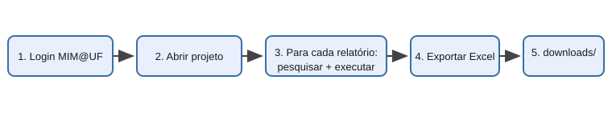
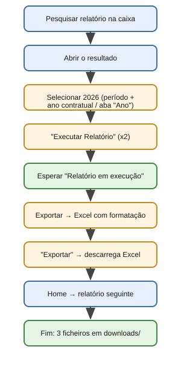

# Manual do Agente MIM@UF — Guia Ilustrado

Este manual explica, passo a passo, o que o agente faz e como o correr na máquina da empresa, **sem instalar nada** (versão PowerShell).

## O que o agente faz (visão geral)



1. Faz **login** no MIM@UF
2. Abre o projeto **"MIM@UF - Hierarquia dos Locais 2015"**
3. Para cada um dos 3 relatórios, segue o fluxo abaixo
4. Guarda cada Excel na pasta **`downloads/`**

## O fluxo de cada relatório



| Passo | O que acontece | Onde |
|-------|----------------|------|
| 1 | Pesquisa o nome do relatório | Caixa de pesquisa no topo (`Pesquisar`) |
| 2 | Abre o relatório da lista de resultados | Resultados da pesquisa |
| 3 | Seleciona o ano **2026** | R01: período + ano contratual · R03/R05: aba "Ano" → 2026 |
| 4 | Clica em **"Executar Relatório"** (duas vezes) | Ecrã de filtros/avisos |
| 5 | Espera enquanto diz "Relatório em execução" | Ecrã de processamento |
| 6 | Clica em **Exportar** → **Excel com formatação** → **Exportar** | Barra de ferramentas do relatório |
| 7 | Volta ao **Home** e repete para o relatório seguinte | Botão Home |

## Como preparar a pasta (1ª vez)

1. Vai a <https://github.com/rmalbuquerque/mimufxray/pull/1> → botão verde **Code** → **Download ZIP**
2. Extrai o ZIP e entra na pasta **`file-downloader-agent`**
3. Cria o ficheiro `.env`: copia o `.env.example`, muda o nome para `.env` e preenche:

```
COMPANY_USERNAME=o.teu.utilizador.do.mimuf
COMPANY_PASSWORD=a.tua.palavra.passe
```

> O ficheiro `.env` nunca deve ser partilhado nem enviado para o GitHub — já está protegido pelo `.gitignore`.

## Como correr

1. Na pasta `file-downloader-agent`, clica na barra de endereço do Explorador, escreve `powershell` e carrega em **Enter**
2. Escreve o comando e carrega em **Enter**:

```
powershell -ExecutionPolicy Bypass -File agent.ps1
```

3. O script faz tudo sozinho. Quando terminar, diz `Concluído` e os 3 ficheiros Excel estão em `downloads/`.

## Se der erro

Corre em modo de depuração para guardar as páginas visitadas:

```
powershell -ExecutionPolicy Bypass -File agent.ps1 -Debug
```

A pasta `debug/` fica com o HTML de cada passo. Envia-me a mensagem de erro do PowerShell (e a pasta `debug/`, se existir) e eu ajusto o script.

## Versão com Python (se puderes instalar)

Se tiveres permissão para instalar Python num computador com acesso à rede interna:

```bash
pip install -r requirements.txt
playwright install chromium
python agent.py
```

## Notas de segurança

- As credenciais ficam apenas no `.env` local
- O agente corre localmente no teu computador e só fala com o servidor do MIM@UF
- Usa-o apenas com a tua conta e para relatórios a que tens acesso
